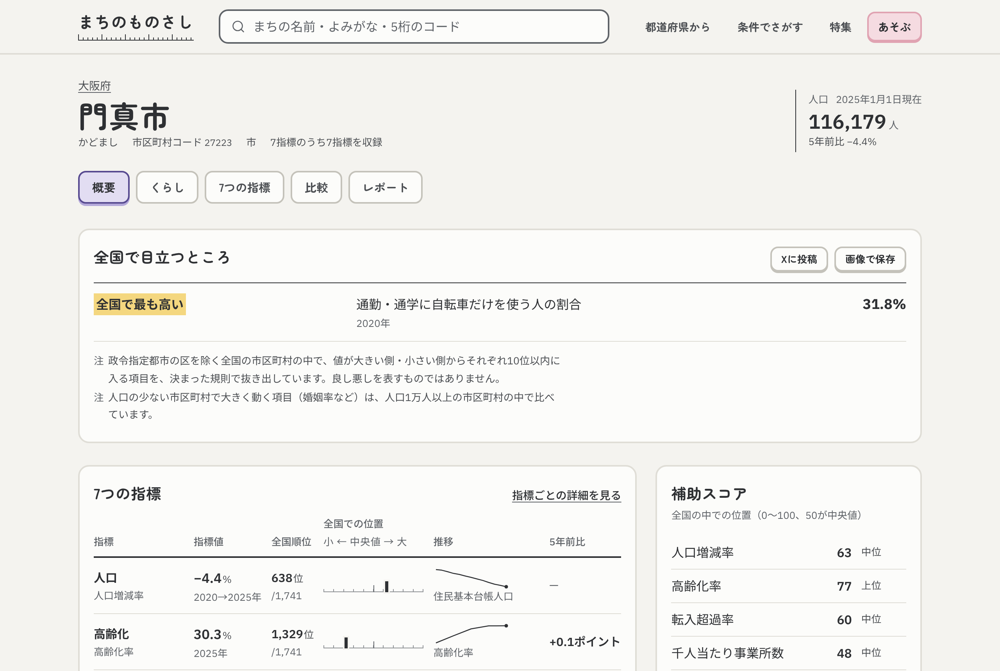

# まちのものさし

（リポジトリ名・英語名: Local Signal Japan）

[](https://github.com/shellcat7/local-signal-japan/actions/workflows/ci.yml)

全国の市区町村を、同じ目盛りで調べて比べる道具です。人口・高齢化・転入転出・事業所・雇用・所得・財政の公開統計を、出典・基準時点・欠損の注記ごと確認できます。

_A dashboard for Japanese municipalities that shows official public statistics together with their sources, reference periods, and missing-data notes. All data comes from the Statistics Dashboard API of the Statistics Bureau of Japan (no API key required) and ships as a static dataset, so the site runs without any backend. The UI and documentation are in Japanese._



## できること

- **名前でさがす**: 市区町村名・よみがな・5桁の市区町村コードで検索（全国約1,900市区町村。政令指定都市の区を含む）。検索欄は、どの画面でも上部の同じ位置にあります
- **都道府県からさがす**: 日本地図の形に並べた都道府県のます目から、その都道府県の市区町村の一覧へ
- **条件でさがす**: 「高齢化率30%以下で、課税対象所得350万円以上」のような条件に合う市区町村を、全1,741市区町村からすべて表示。くらしの指標でも絞り込み・並べ替えができ、結果は表か色分け地図で見られる。CSV で保存
- **特集**: 「2050年に人口が半分以下になる見込みの市区町村」「ふるさと納税の受入額が多い市区町村」「通勤・通学に自転車だけを使う人の割合が高い市区町村」など、決まった条件で並べた15本の一覧
- **全国で目立つところ**: 市区町村ごとに、全国の上位・下位10位以内に入る項目を決まった規則で抜き出して表示（例: 大阪府門真市は、通勤・通学に自転車だけを使う人の割合が全国で最も高い）
- **くらし**: 平均寿命、2050年の推計人口、外国人住民の割合、婚姻率・出生率、通勤手段、空き家率、住宅の広さ、医師・図書館の数、ごみ、ふるさと納税など22項目を、全国順位と出典つきで
- **あそぶ**:
  - **まちくじ**: ボタンを押すと全国1,741市区町村から1つが出て、そのまちが全国や都道府県の中で目立つところを3つまで読める（例: 群馬県大泉町は、外国人住民の割合が全国で3番目に高い）。都道府県で絞って引くこともでき、結果はリンクと画像で共有できる
  - **まちクイズ**: 「空き家率が全国で最も高い市区町村は？」のような4択が5問。日替わり（日本時間の0時に変わる）で、同じ日ならだれでも同じ問題。問題を「Xに出題」でき、結果は「🟨⬜🟨🟨🟨 4/5」の形で投稿できる
  - **まち図鑑**: 引いたまちを日本地図に塗って集め、47都道府県の制覇をめざす。利用者が「はじめる」を押したときだけ、この端末のブラウザに記録する
- **画像で保存・Xに投稿**: ランキング・地図・「全国で目立つところ」・まちくじの札・クイズの問題と結果・図鑑を、出典を描き込んだ画像（1200×675）にしてその場で保存
- **概要**: 7つの指標の指標値・全国順位・全国での位置・推移・5年前比を1つの表で確認。補助スコアの内訳と、読み取り時の注意・欠損
- **指標**: 指標ごとの値、基準時点、時系列グラフ、全国の分布の中での位置、算出方法、出典の系列と取得日
- **比較**: 全国のどの市区町村とも4つまで並べて比較（指標の傾向が近い市区町村を候補として提示）。同じ都道府県内での比較
- **レポート**: 同じ内容を Markdown でダウンロード・コピー

開いている画面（市区町村、比較の組み合わせ、さがす条件）は、そのまま URL で共有できます。

## LLM の検索との使い分け

LLM に条件を伝えて検索させると、いくつかの例は返ってきますが、条件に合う市区町村を全部は挙げられず、時点や定義の違う数字が混ざることがあります。同じ質問でも答えが変わります。

このリポジトリが受け持つのは、その苦手な部分です。全国の市区町村を同じ定義・同じ時点でそろえ、全件を検算したデータセットと、その上の決まった計算だけを提供します。

- 人が使う入口: 画面（条件でさがす、比較、出典の値そのものへのリンク）
- LLM エージェントが使う入口: [`skills/local-signal-japan`](skills/local-signal-japan/SKILL.md)。同じデータを、出典と基準時点つきの JSON で返すスクリプトと、答え方の決まりをまとめたスキルです

## 設計上の約束

- **出典と基準時点を必ず示す。** すべての値に、出典の統計名・系列コード・基準時点・取得日を添えます。各指標のリンクから、出典の値そのものを確認できます。
- **断定しない。** 「この地域は成長している／衰退している」といった判定はしません。補助スコアは全国の中での相対的な位置を示すだけです。
- **欠損を低い評価として扱わない。** 値がそろわない指標は「欠損」と表示して理由を添え、平均から除きます。
- **入力を保存・送信しない。** 検索はブラウザの中で完結します。サーバー側のプログラム、アクセス解析、Cookie はありません。外部への通信は Content-Security-Policy で禁止しています。
- **APIキーが要らない。** 出典は利用登録不要の API と公開ファイルで、取得済みのデータをリポジトリに同梱しています。公開に必要な設定はありません。

## 収録している指標

| 指標       | 指標値                            | 元の統計                               |
| ---------- | --------------------------------- | -------------------------------------- |
| 人口       | 5年間の人口増減率                 | 住民基本台帳人口（社会・人口統計体系） |
| 高齢化     | 高齢化率（65歳以上人口の割合）    | 国勢調査                               |
| 転入・転出 | 転入超過率（直近3年平均）         | 社会・人口統計体系                     |
| 事業所     | 人口千人当たりの民営事業所数      | 経済センサス                           |
| 雇用       | 完全失業率                        | 国勢調査（社会・人口統計体系）         |
| 所得       | 納税義務者1人当たりの課税対象所得 | 社会・人口統計体系                     |
| 財政       | 財政力指数                        | 社会・人口統計体系                     |

このほか、補助スコアの対象にしない「くらしの指標」を22項目収録しています（平均寿命、2050年の推計人口、外国人住民の割合、婚姻率、出生率、高齢者の一人暮らし、通勤・通学の手段、空き家率、住宅の広さ、医師・図書館の数、ごみの量・リサイクル率、ふるさと納税の受入額・費用の割合・住民税の控除額）。

算出方法は [docs/METHODOLOGY.md](docs/METHODOLOGY.md)、系列コードと取得のしかたは [docs/DATA_SOURCES.md](docs/DATA_SOURCES.md) にあります。

## はじめかた

Node.js 22.12 以上が必要です。pnpm は Corepack 経由で使います。

```bash
corepack enable
```

```bash
pnpm install
```

```bash
pnpm dev
```

<http://127.0.0.1:5173/> を開きます。データは同梱済みなので、そのまま動きます。

Windows で `corepack enable` が権限エラーになる場合は、`npm install -g pnpm@10` で pnpm を入れてから `pnpm install` を実行してください。

## CLI

同梱データセットを、コマンドラインから検索・表示・レポート出力できます。

```bash
pnpm localsignal search 府中
```

```bash
pnpm localsignal show 13101
```

```bash
pnpm localsignal report 横浜市青葉区 --out report.md
```

`show` は、7つの指標、くらしの指標、全国で目立つところを表示します。`show --json` で、同じ内容を JSON で出力します。

条件に合う市区町村をもれなく抜き出すには `screen` を使います（画面の「条件でさがす」と同じ計算です）。

```bash
pnpm localsignal screen --where "aging<=25" --where "income>=400" --pref 東京都 --sort income
```

```bash
pnpm -s localsignal screen --where "fiscal>=1" --size 10k-50k --limit 0 --csv > result.csv
```

- `--where "<指標キー><演算子><数値>"`: 演算子は `>=` と `<=`。何度でも指定でき、同じ指標に両方を付けると範囲になります。指標キーは `population`（5年間の人口増減率）、`aging`、`migration`、`business`、`employment`、`income`、`fiscal`
- くらしの指標のキーも使えます: `lifeFemale`・`lifeMale`（平均寿命）、`projection2050`（2050年推計人口）、`foreignShare`（外国人住民）、`marriageRate`・`birthRate`（婚姻率・出生率）、`elderlyAlone`（高齢者の一人暮らし）、`commuteRail`・`commuteCar`・`commuteBike`・`commuteWalk`（通勤手段）、`vacancy`（空き家率）、`floorArea`（住宅の広さ）、`doctors`・`libraries`（医師・図書館の数）、`garbage`・`recycling`（ごみ）、`furusatoReceipts`・`furusatoPerCapita`・`furusatoCostShare`・`furusatoOutflow`・`furusatoNet`（ふるさと納税）。金額は円で指定します（例: `--where "furusatoReceipts>=1000000000"`）
- `--sort residents|overall|<指標キー>`（既定は人口）、`--order desc|asc`、`--pref <都道府県名か2桁コード>`、`--size all|over-10k|under-10k|10k-50k|50k-200k|over-200k`、`--limit N`（既定20、0で全件）、`--json`、`--csv`、`--out <ファイル>`
- 出力には、条件、該当した市区町村の数、各指標の基準時点、出典が入ります。並べ替えに使う値が欠損の市区町村は、順位なしで末尾に残ります

特集は `topics` で見られます（計算は `screen` と同じ。既定は20件）。

```bash
pnpm localsignal topics
```

まちくじは `kuji` です（`--pref` でその都道府県の中から引きます）。

```bash
pnpm localsignal kuji --pref 群馬県
```

```bash
pnpm localsignal topics half-by-2050 --limit 5
```

## エージェント用スキル

[`skills/local-signal-japan`](skills/local-signal-japan/SKILL.md) は、このデータセットを LLM エージェントから引くためのスキル（SKILL.md 形式）です。フォルダごと、お使いのエージェントのスキル用フォルダにコピーします。Node.js 18 以上があれば、追加のインストールは要りません。

```bash
node skills/local-signal-japan/scripts/lsj.mjs screen --where "aging<=25" --pref 東京都 --limit 0
```

```bash
LSJ_DATA=apps/web/public/data node skills/local-signal-japan/scripts/lsj.mjs show 東京都府中市 --text
```

コマンドは `indicators`、`search`、`show`、`screen`、`compare`、`topics` です。くらしの指標と、全国で目立つところも扱えます。既定の出力は JSON で、どの結果にも出典（ふるさと納税を含むときは総務省の出典も）と指標ごとの基準時点が付きます。同じ名前の市区町村があるとき（府中市など）は、推測せずに候補を返します。

データは既定で公開サイト（`https://local-signal-japan.pages.dev/data/`）から読みます。`--data` か環境変数 `LSJ_DATA` で、手元のフォルダや別の URL に変えられます。

## データの更新

```bash
pnpm data:refresh
```

統計ダッシュボード API から最新の統計を取得し、`apps/web/public/data/` を作り直します（APIキー不要、1分ほど）。GitHub Actions の「データ更新」ワークフローが毎月これを実行し、統計値に変更があればプルリクエストを作ります。

## 公開

```bash
pnpm build
```

`apps/web/dist/` を静的ファイルとして配信するだけです。このリポジトリは Cloudflare Pages の Git 連携で公開しており、main へのマージで本番が更新されます。設定と、GitHub Pages を使う場合の手順は [docs/DEPLOY.md](docs/DEPLOY.md) にあります。

## 開発

```bash
pnpm preflight
```

整形・Lint・型検査・単体テスト・同梱データセットの検査・秘密情報の検査・ビルドをまとめて実行します。

```bash
pnpm exec playwright install chromium
```

```bash
pnpm test:e2e
```

ブラウザでの動作確認です（主要な操作、アクセシビリティ、横はみ出し、外部通信をしないこと）。

構成と設計判断は [docs/ARCHITECTURE.md](docs/ARCHITECTURE.md) にまとめています。

| 場所               | 役割                                                              |
| ------------------ | ----------------------------------------------------------------- |
| `apps/web`         | 画面（React + Vite）。`public/data/` に同梱データセット           |
| `apps/cli`         | CLI                                                               |
| `packages/core`    | 指標の定義、補助スコア、順位、シグナルの文章、レポート、検索      |
| `packages/dataset` | 統計ダッシュボード API からの取得と、データセットの組み立て・検査 |
| `skills`           | LLM エージェント用のスキル                                        |
| `e2e`              | ブラウザでの動作確認                                              |

## ドキュメント

- [算出方法](docs/METHODOLOGY.md)
- [データの出典](docs/DATA_SOURCES.md)
- [構成](docs/ARCHITECTURE.md)
- [公開（デプロイ）](docs/DEPLOY.md)
- [プライバシー](docs/PRIVACY.md)
- [セキュリティ](SECURITY.md)
- [ロードマップ](docs/ROADMAP.md)
- [変更履歴](CHANGELOG.md)

## 出典とクレジット

出典：[統計ダッシュボード](https://dashboard.e-stat.go.jp/)（総務省統計局）のデータを加工して作成

このサービスは、統計ダッシュボードのAPI機能を使用していますが、サービスの内容は国によって保証されたものではありません。

出典：総務省「ふるさと納税に関する現況調査結果」を加工して作成

地図：国土数値情報（行政区域データ）（国土交通省）を加工して作成（[CC BY 4.0](https://creativecommons.org/licenses/by/4.0/deed.ja)）

統計データは[公共データ利用規約（第1.0版）](https://dashboard.e-stat.go.jp/static/terms)に基づいて利用しています。派生物を公開するときも、上の出典の記載とクレジット表示を残してください。

## ライセンス

ソースコードは [MIT License](LICENSE) です。同梱している統計データには、上記の利用規約が適用されます。画面に同梱している書体（IBM Plex Sans、IBM Plex Mono、Zen Maru Gothic）は [SIL Open Font License 1.1](https://openfontlicense.org/) です。
